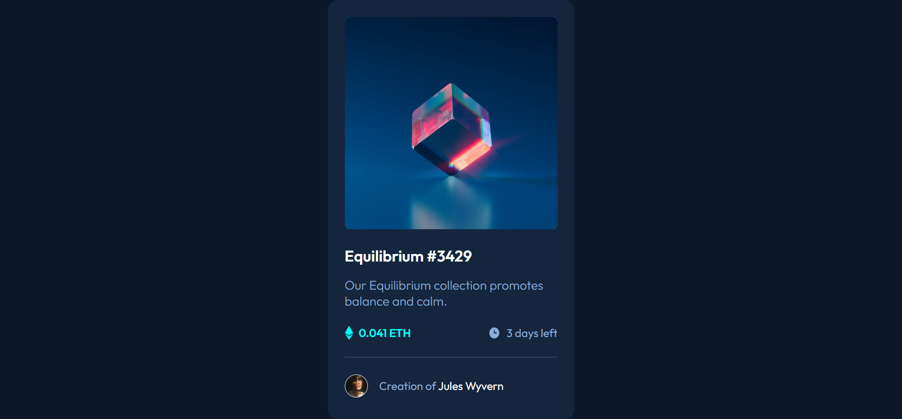

# Frontend Mentor - NFT Preview Card Component Solution

This is a solution to the [NFT preview card component challenge on Frontend Mentor](https://www.frontendmentor.io/challenges/nft-preview-card-component-SbdUL_w0U).

## Table of contents

- [Overview](#overview)
  - [Screenshot](#screenshot)
  - [Links](#links)
- [My process](#my-process)
  - [Built with](#built-with)
  - [What I learned](#what-i-learned)
  - [Continued development](#continued-development)
  - [Useful resources](#useful-resources)
  - [AI Collaboration](#ai-collaboration)
- [Author](#author)
- [Acknowledgments](#acknowledgments)

## Overview

### Screenshot

### Links

- [Solution URL](https://github.com/ia-path/fem_design_nft-preview-card-component)
- [Live Site URL](https://ia-path.github.io/fem_design_nft-preview-card-component/)

## My process

### Built with

- Semantic HTML5 markup.
- CSS custom properties.

### What I learned

- Use position properties.

### Continued development

- CSS variables.
- Importing fonts locally.
- Using the BEM convention.

### Useful resources

- NIL.

### AI Collaboration

- I used Copilot to understand some spacing errors that occurred.

## Author

- Frontend Mentor - [@ia-path](https://www.frontendmentor.io/profile/ia-path)

## Acknowledgments

- NIL.